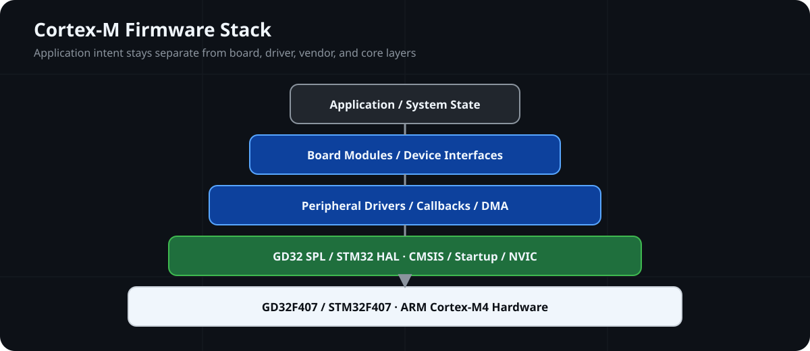
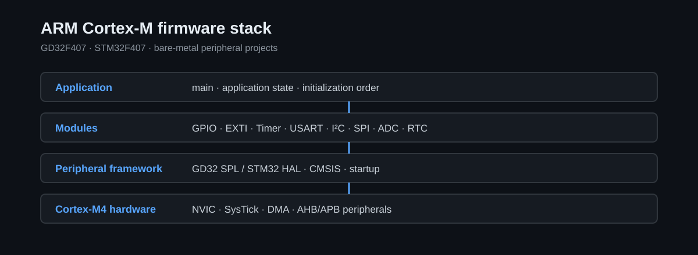

# ARM-Cortex-M-Development-Lab

面向 GD32F407 / STM32F407 Cortex-M4 的启动、中断、时钟与外设架构文档实验。

**⚙️ Cortex-M Firmware Stack**



## Firmware Snapshot

| Firmware Focus | Current Scope |
| --- | --- |
| Repository Type | Cortex-M Architecture Lab |
| Reference Platforms | GD32F407VE、STM32F407、ARM Cortex-M4 |
| Architecture | Application → Board Module → Driver → CMSIS / Vendor Interface |
| Documentation | Startup、clock、NVIC、interrupt、peripheral mapping、firmware layering |
| Public Implementation | Not included in the current default branch |
| Verification | Architecture review；build and hardware evidence not provided |

## 📌 Overview

仓库整理 Cortex-M4 固件的启动链、时钟树、Vector Table、NVIC、中断回调、外设资源映射和固件分层方法。GD32 与 STM32 只作为平台参考，不被描述成当前已发布、可直接构建的完整工程。

当前默认分支不再分发课程应用、CMSIS 副本、GD32/STM32 厂商库、startup 文件、CubeMX 工程或外部硬件图片。需要实现时，应从对应厂商或 ARM 官方渠道取得组件并遵循其许可证与版本要求。

## 🏗️ Architecture



```text
Application / System State
            ↓
Board Modules / Device Interfaces
            ↓
Peripheral Drivers / DMA / Callbacks
            ↓
Vendor Library Interface
            ↓
CMSIS / Startup / NVIC / SysTick
            ↓
Cortex-M4 Hardware
```

## ✨ Key Features

| Capability | Documentation Entry |
| --- | --- |
| Startup and vector-table model | [Architecture](docs/architecture.md) |
| Clock-tree reasoning | [Clock System](docs/clock-system.md) |
| Interrupt and NVIC boundary | [Interrupt System](docs/interrupt-system.md) |
| Firmware layer responsibilities | [Firmware Architecture](docs/firmware-architecture.md) |
| Peripheral resource mapping | [Peripheral Map](docs/peripheral-map.md) |
| Toolchain boundary | [Development Environment](docs/development-environment.md) |

## 📂 Project Structure

```text
ARM-Cortex-M-Development-Lab/
├── README.md
├── LICENSE
├── THIRD_PARTY_NOTICES.md
├── assets/images/architecture/  # Repository-authored SVG
└── docs/                        # Cortex-M architecture documentation
```

## 📚 Documentation

- [Architecture](docs/architecture.md)
- [Clock System](docs/clock-system.md)
- [Interrupt System](docs/interrupt-system.md)
- [Firmware Architecture](docs/firmware-architecture.md)
- [Peripheral Map](docs/peripheral-map.md)
- [Development Environment](docs/development-environment.md)

## 🧪 Verification

| Verification Layer | Status | Boundary |
| --- | --- | --- |
| Host Test | NOT APPLICABLE | No public host-test implementation |
| Build Verification | NOT PROVIDED | No current Keil or CubeMX project is distributed |
| Hardware Validation | NOT PROVIDED | No reviewable GD32F407 or STM32F407 board record |
| Runtime Evidence | NOT PROVIDED | No serial log, waveform, or measurement result |

## License Boundary

根目录 MIT License 仅覆盖当前默认分支中仓库维护者编写的文档、配置与自绘 SVG。课程源码、CMSIS、厂商库、startup、工程文件和外部图片未包含在当前默认分支；历史提交风险单独保留。详见 [THIRD_PARTY_NOTICES.md](THIRD_PARTY_NOTICES.md)。
