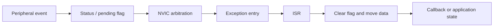

# 中断系统 | Interrupt System

## 事件路径 | Event Path

Cortex-M 外设事件通过以下路径进入固件：

该事件模型适用于 GPIO 边沿、USART 接收、Timer 更新、DMA 完成和 RTC Alarm 等常见中断路径。当前默认分支已有[可移植的 Timer 事件入队与主循环控制核心](control-foundation.md)，但没有目标 MCU 的中断向量、Timer 驱动或其他外设 ISR 实现。

## EXTI 路由 | EXTI Routing

EXTI 工程配置 GPIO 输入、引脚到 EXTI Line 的映射、触发边沿和对应 NVIC Channel。处理函数检查并清除 Pending Flag，再分发注册的动作。按键路径使用 SysTick 计时，避免在 ISR 中使用无界延时完成消抖。

实现时需要把 EXTI 配置、IRQ Handler 与应用回调分开，并明确 pending flag 的清除责任。

## USART 与 DMA 中断

USART 接收处理读取输入数据、更新缓冲区并进入回调。DMA 工程增加传输配置和完成处理，避免 CPU 在前台逐字节搬运。

实现时需要分别记录 USART 错误、中断接收、DMA 完成与缓冲区所有权，避免把中断到达等同于完整消息有效。

## 优先级与处理规则

- 分配抢占优先级和响应优先级前先配置 Priority Grouping。
- 处理完成后清除对应的外设或 EXTI Pending Flag。
- 阻塞传输和长延时留在中断上下文之外。
- 通过明确的缓冲区、标志或回调与前台代码共享数据。
- 合并独立工程前先处理共用 IRQ Handler。
